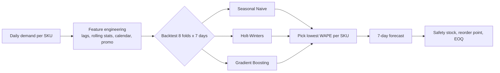

# 📦 Inventory Demand Forecasting


> 🌌 Part of **[BRIHA AI World](https://github.com/asad110abbas)**, the AI-driven portfolio of Syed Asad Abbas.

Forecast daily SKU demand and turn it into **inventory decisions**: safety stock, reorder point and economic
order quantity. Three models compete per SKU in a **rolling-origin backtest**, and the winner drives the reorder plan.

## Pipeline


## Models
| Model | Idea |
|---|---|
| Seasonal Naive | Same weekday last week. The baseline every model must beat |
| Holt-Winters | Exponential smoothing with additive trend and weekly seasonality |
| Gradient Boosting | `HistGradientBoostingRegressor` on lags (7/14/28), rolling mean/std, calendar and promo flags, built leak-free |

**Metrics:** WAPE (primary, robust to low-volume days), MAE and forecast bias.

## Inventory policy
- Safety stock = z(service level) × σ(daily demand) × √(lead time)
- Reorder point = forecast demand over lead time + safety stock
- EOQ = √(2 × annual demand × order cost ÷ holding cost)

## Quick start
```bash
pip install -r requirements.txt
python -m forecasting.cli --skus 12 --lead-time 10 --service-level 0.95
pytest -q
```
Outputs in `reports/`: `backtest_scores.csv`, `leaderboard.md`, and `reorder_plan.csv` (one row per SKU with the best model, next-7-day forecast, safety stock, reorder point and EOQ).

## Structure
```
forecasting/
  data.py        synthetic demand generator (trend, seasonality, promos, noise)
  features.py    leak-free lag / rolling / calendar features
  models.py      SeasonalNaive, HoltWinters, GradientBoosting
  evaluate.py    rolling-origin backtest, WAPE / MAE / bias
  inventory.py   safety stock, reorder point, EOQ
  cli.py         end-to-end pipeline
tests/           pytest suite
```

> The data is synthetic and generated with a fixed seed.
